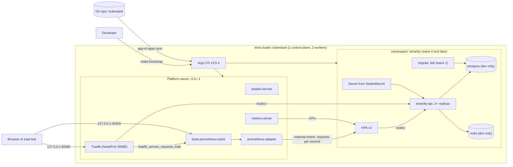

# Kubestack

[](https://github.com/iboondk/kubestack/actions/workflows/ci.yml)
<!-- The badge above is a placeholder. It shows the real CI status only after the repo is pushed to GitHub and the workflow has run once. -->

Kubestack runs the Tenantly API on a local Kubernetes cluster with GitOps, autoscaling on CPU and on requests per second, SealedSecrets, Prometheus and Grafana, and a chaos test that kills pods and measures recovery.

Everything runs on your own machine. Nothing is deployed to a cloud, nothing costs money, and no real credentials are used. The only secrets file is `.env.example`, and it holds placeholders.

- **Cluster:** [kind](https://kind.sigs.k8s.io/) v0.33.0, one control-plane node and two workers.
- **Packaging:** a Helm 3 chart in `charts/tenantly`.
- **Delivery:** Argo CD v3.5.4, app-of-apps pattern, sync waves.
- **Autoscaling:** an HPA on CPU (metrics-server) and on `tenantly_requests_per_second` (Traefik metrics through prometheus-adapter).
- **Secrets:** SealedSecrets.
- **Monitoring:** kube-prometheus-stack with two Grafana dashboards.
- **Resilience:** `scripts/chaos.sh` with pod-kill, node-drain and db-kill experiments.

## Architecture



Requests per second are measured at the Traefik edge, because the Tenantly API has no Prometheus `/metrics` endpoint. See [ADR-0003](docs/ADR-0003-rps-measured-at-traefik-edge.md). The full design, with sync waves and version pins, is in [docs/architecture.md](docs/architecture.md).

## Quick start

There is no `docker compose` file. The stack needs a Kubernetes cluster and Argo CD, so `docker compose` does not apply. The Makefile is the entry point.

### Offline checks (no Docker, no cluster)

These run on any machine with Python 3.10 and PyYAML. Go 1.26 or newer is needed only for `make tools`.

```bash
make tools      # builds helm and kubeconform into .tools/bin/ (needs Go)
make test       # 78 unit tests, standard library plus PyYAML
make validate   # offline checks: YAML, JSON, pins, attribution, internal codes
make lint       # helm lint and template (3 values files), kubeconform, validator, unittest -> proof/
make chaos-dry  # prints the chaos plan with kubectl commands prefixed DRY-RUN:
```

`make lint` prints a SKIPPED line for any tool it cannot run. It never reports a skipped step as PASS.

### Full demo (needs Docker, kind, kubectl, kubeseal, and the Tenantly API source)

```bash
make cluster-up                 # kind cluster "kubestack"
make image                      # docker build of ../tenantly (or TENANTLY_SRC), kind load
make repo-url REPO_URL=https://github.com/<you>/kubestack.git   # point Argo CD at your fork
make bootstrap                  # Argo CD and the root app-of-apps
cp .env.example .env            # then replace every change-me value in .env
make seal                       # writes charts/tenantly/values-sealed.yaml
make load                       # hey load through Traefik, for the HPA
make chaos                      # kill pods, drain a node, kill postgres, write a report
make down                       # delete the cluster
```

The step-by-step runbook, with troubleshooting, is in [docs/RUNBOOK.md](docs/RUNBOOK.md). To record the demo, follow [DEMO.md](DEMO.md).

If the Tenantly source is missing, use the demo values. They run podinfo in place of Tenantly, with the same port, health path and metrics layout. See Step 2 of the runbook.

## Repository layout

| Path | What it holds |
|---|---|
| `charts/tenantly/` | The Helm chart: API, migrate Job, dev Postgres and Redis, Ingress, HPA, PDB, ServiceMonitor, dashboards |
| `argocd/` | Root Application and six child Applications (sync waves -3 to 0) |
| `platform/` | Values files for the upstream charts (Traefik, kube-prometheus-stack, metrics-server, prometheus-adapter) |
| `scripts/` | Cluster, image, bootstrap, seal, load and chaos scripts, plus `lint.sh` |
| `kind/cluster.yaml` | Three-node kind cluster with host port mappings on 127.0.0.1 |
| `images/tenantly/Dockerfile` | Multi-stage build of the Tenantly API and migrate binaries |
| `versions.env` | The single source of every pinned version |
| `tools/validate.py` | Offline validator (YAML, JSON, pins, attribution, internal codes) |
| `tests/` | Python unit tests (`make test`) |
| `proof/` | Output from `make lint`: helm lint and template, kubeconform, validator, unittest |
| `docs/` | Runbook and Architecture Decision Records |
| `.github/workflows/ci.yml` | CI: unit tests, validator, and Helm lint and template |

## Tests and CI

- `make test` runs the unit tests. Chart render tests run when `.tools/bin/helm` exists and are skipped otherwise.
- `make validate` runs the offline validator.
- `.github/workflows/ci.yml` runs the tests and the validator on every push and pull request. A second job installs Helm 3.22.0 and runs `helm lint` and `helm template` for each values file.
- kubeconform and the cluster steps are not in CI. kubeconform needs a binary build, and the cluster steps need Docker and a real cluster.

## Limits

- The stack has been checked offline only. The cluster, image build, Argo sync, sealing, HPA scaling and chaos runs have not been run on a machine with Docker. `proof/chaos/` stays empty until someone runs the chaos script for real.
- `make tools` puts the Go module cache in `.tools/gomodcache` unless `GOMODCACHE` is already set (on the original build machine it uses `/Volumes/Hazel/caches/go`).
- Postgres and Redis are dev-only templates with no backups and no HA.
- The Tenantly API source is a separate repo. This repo cannot build the image without it.

## License

MIT. Copyright (c) 2026 iboondk. See [LICENSE](LICENSE).
